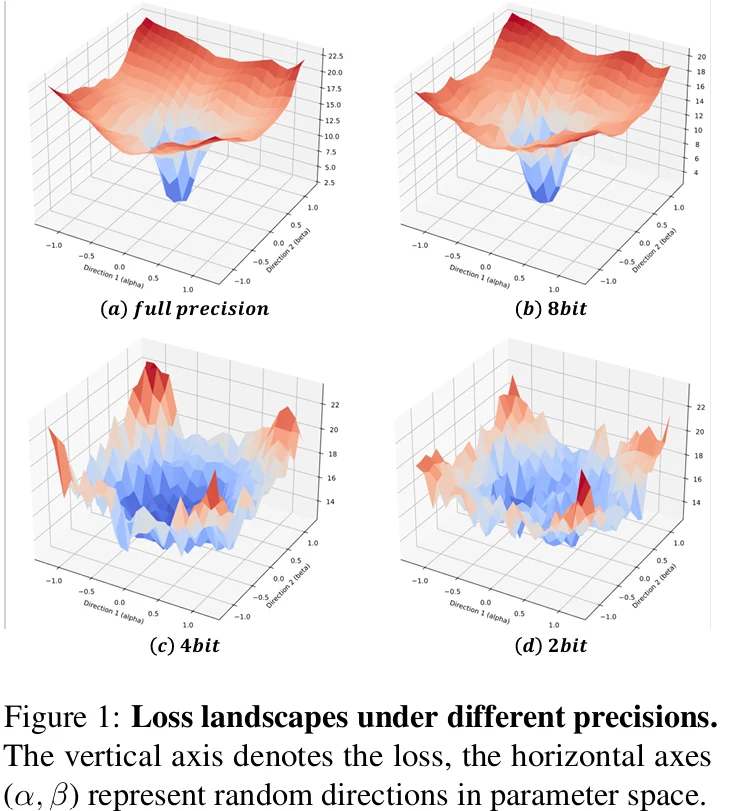
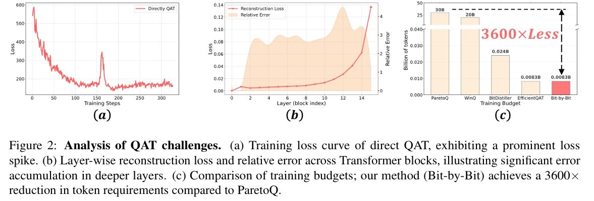

# Bit by Bit ： Progressive QAT Strategy with Outlier channel Splitting For Stable Low-bit llms

BTC-LLM 研究如何把已经binary 的权重压缩到1-bit以下，Bit-by-bit则研究如何让LLM 在 2-bit weight,甚至 2-bit Activation 的条件下稳定完成量化感知训练（QAT）

# Abstract
论文开头指出:

Training LLMs at Ultra-low Precision remains a formidable challenge.

1. 训练不稳定
如果一个FP16 LLM 进入W2A2训练，模型可能出现严重的Loss Spike，甚至无法收敛
2. 量化误差沿着网络深度累积
前一层发生的量化误差会改变后一层接收到的 Activation, 进而影响后续计算。

为什么low bit训练更难?

我们可以先建立一个直觉，当量化位宽越低的时候，连续权重会被映射到越来越少的离散点上面，于是模型优化不再像FP16那样平滑，例如 2-bit量化可能只能将一组权重映射到4个离散级别，即使FP16 Master weight 发生了小幅变化，量化后的值也可能完全不变。

(a) Direct QAT 的训练Loss出现了明显的Spike，作者以此说明直接低比特量化不稳定
(b) 深层block的重建误差大，这说明量化误差沿着深度累积
(c) 报告训练token降低了 3600倍，说明渐进式训练可以节约训练预算

因此，他们提出了三个核心贡献

|方法 | 思想 | 问题 |
| --- | ---- | ----|
| Progressive QAT| 从高精度逐步过渡到低精度 | 直接2bit训练很难收敛 |
| Once - for - any - precision | 共享嵌套量化神经网络，共享训练之后的参数 | 不同位宽分别训练成本高 |
| Rouding-aware OCS | 分裂异常通道 并控制舍入误差 | Outlier导致量化损失 |

我们分开来讲讲这三个核心的贡献。
## 1. Progressive QAT
其实第一个是很明显的，当我们想让量化模型直接和完整大模型对齐的时候，那当然他是学不动的！所以我们不妨采用从 FP16 逐步下降的思路。

首先，从 W8A16 -> W4A16 -> W2A16
再 W2A16 -> W2A8 -> W2A4 -> W2A2

思路就比较像模型训练里面的 Curriculum Learning, 先在较容易量化的8-bit环境中确立稳定参数，再逐步增加量化噪声。

并不是直接改善某个量化器的表达能力，而是改善优化路径。

## 2. Once-for-any-precision

然后我们看看他们声称的第二种贡献吧: 作者希望不要训练三个模型，而是训练一个共享Master weight,让不同位宽使用嵌套的离散表示。

例如，在共享scale的条件下，通过位移映射高比特整数编码，得到对应的低精度表示。这样就可以共同优化多个精度目标

## 3.Rouding-aware Outlier Channel Splitting

这个是AWQ的时候就比较熟悉的思路，Outlier channel 很容易影响量化scale，从而让其他权重的量化误差变大，而作者不直接clipping, 而是直接把异常通道拆开变成两条路径，分摊原本的权重贡献。
另外，作者还加入了和量化步长有关的偏移，希望可以减少分裂之后重新量化带来的Rounding Error

相比于传统OCS，这个不是赋值通道，核心是Rounding -aware 的设计。

所以这篇文章的一个核心思路就是这三点，可能看起来还是比较简单的。

# Methodology

## Progressively Bit-by-Bit QAT

为什么直接进行2-BIT QAT很困难？我们跟着作者的观察来看，在FP16下，我们优化的是连续权重

$$min_{W} L(w) $$

但是在QAT中，Forward使用的是量化权重

$$min_{W} L(Q_b(W)) $$

这里的W仍然是可以更新的浮点master weight，Qb(W) 才是参与前向计算的低比特权重。

当b = 2，量化器只能提供4个离散级别了。这样就会产生两个问题
- 第一  Gradient Mismatch ， 权重的小幅变化完全没有办法改变forward里面的量化结果，但是STE仍然传递近似梯度
- 第二 Optimization Instability 在某个Quantization Threshold附近，权重的微小变化可能让量化输出突然跳到另外一个级别。

所以作者采用的是类似Continuation Method / Homotopy的思想

先解决一个相对容易的优化问题，先算出来W8，然后再把W8当成基准，优化W4，最后再进入W2。

这种渐进策略是一种经验的算法。

## Block-wise Reconstruction

假设我们有一个包含L个 Transformer Blocks 的模型
$$ x_{i+1} = F_{i}(x_iW_i) $$
即使每个block自身的weight error 差距不大，经过多层非线性变换，最终的偏差仍可能很明显。

所以作者采用了 Block Wise Reconstruction Loss. 不过它有一个值得注意的设计，训练当前low 比特block 的时候，输入来自前面稍高精度匹配的blocks

这样，当前block 不必同时适应所有前序blocks 的严重低比特扰动。

## Once-for-any-precision

这个地方就很自然了嘛。你想想，你在训练的过程中，你训练是逐步从高往下训练的，那么我们中间产生了的模型，我们为什么要丢掉这些中间状态呢？所以我们自然就可以从上

Bit-by-bit 利用整数量化网格的嵌套关系，训练一个共享的Master weight ， 并联合优化不同精度。

$$ L = \sum_{b ∈ {8，4，2}} λ_b MSE(yhat,y) $$

训练的目标逐步扩展，共享量化scale，让低比特编码可以从高比特编码移位得到。

## Rounding Aware Outlier Channel Splitting

传统OCS 的 思路很简单，对
$$ y = x_m w_m $$

把一个通道拆开成两个，有
$$ x_m w_m = x_m (w_m/2) + x_m (w_m/2) $$

这样权重幅值减半，同时保持原始浮点计数不变。但问题是，分裂前后浮点计算等价，不意味着量化后等价

所以作者引入了和量化Step size s 有关的偏移,这两个对称偏移可以在固定量化步长、合适的舍入与不饱和条件下，能够保持量化贡献的一致性。

然后，我们怎么知道哪些通道需要我们的分裂？ 作者使用 Activation-aware 的思想：一个通道的量化敏感性取决于输入激活强度和对应权重的幅值。

## MicroScaling

作者采用 
- group size = 32
- 每个 group 存储一个 FP8 E4M3 Scale
- Weight 使用 2bit整数

则 scale 的 存储开销为 0.25 BPW， 加上权重之后就是 2 + 0.25 = 2.25 BPW

# Experiment

Table3给出:
|配置 | PPL |
| --- | --- |
|直接训练| 1700 |
|Block-wise| 31.88|
|Block-wise | 24.60|
|OCS| 17.07 |

改善训练目标与优化路径的作用远大于某个单独的量化技巧

然后，W2A2的主结果中

|模型 | FP16 PPL | EfficientQAT W2A2 | Bit-by-Bit W2A2 |
|-----|-----------|-----------------|-------------------|
|LLama-2-7B| 5.47 | 9.71 | 7.72 |
|LLama-3.2-3B| 7.81| 20.19 |13.87|
|LLama-3-8B| 6.13 | 17.93| 11.51|

实验支持作者关于极低比特QAT稳定的主张。
