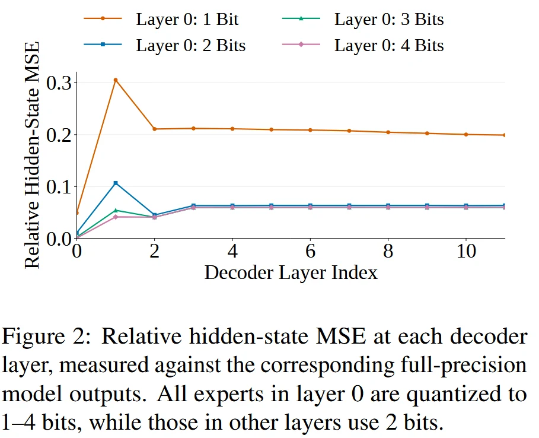
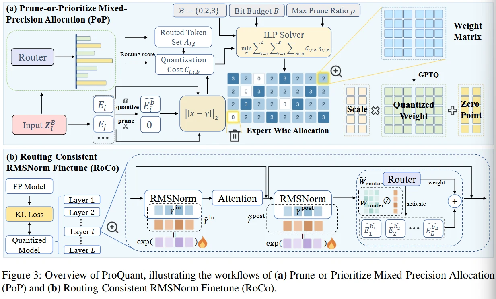
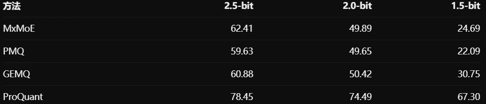

# Proquant: Preserving Expert Quality Over Quantity In Ultra Low Bit Quantization of Mixture-of-experts Models

- pre print, 10-22

简单来说，作者讨论了一个事情，在极低比特的预算下，我们是否应该牺牲一部分的Expert数量，换取剩余expert更高的质量

# Abstract:

现有的moe Mixed-precision Quantization 虽然可以根据expert的重要性分配bitwidth，但是在极低比特的预算下，模型的Generation Quality仍然会严重下降。

作者归纳出来的原因有两个:

1. 极低比特的误差不是局部的，之前我们看的BitsMoE 给出的是一个expert的局部误差小，并不保证最后的总的影响也小，尤其是1-bit的极端情况

从上图中可以看出，若首层采用 低比特量化，那么产生的hidden states error在后续多个decoder layer还会比较大。

而当我们在前面的层使用 2/3/4 bit的时候，误差就会小很多。

所以作者提出"1bit的expert可能会严重丧失原本的功能，而后续层未必能够有效补偿这种损失。"

**不过这个地方我觉得可能不是补偿损失的意思？会不会就是说让模型输出的东西尽量把高精度往前面推，尝试下layerskip的类似思路?**

2. Router Fine-tuning 可能导致 Routing Drift

一些MoE Quantization 方法会在量化后完成 Fine-tune Router,希望重新分配token，让模型适应已经量化的expert

但是作者认为，直接调整router可能导致

- calibration set 上面的PPL 改善
- expert selection 和FP16 模型发生偏移
- 下游生成任务上的表现反而会变差

**这个地方我感觉有些奇怪。因为我感觉量化模型是以输出接近为目标的，那么也就是说router应该更贴近其自己的权重，强行让模型贴近自己，靠近原始FP16是不是不大合适？**

作者在这个地方提出希望 **在不直接改变Router行为的前提下，让量化模型适应量化误差**

所以我们可以看看作者的核心contribution

1. POP - Prune-or-Prioritize Mixed-Precision Allocation 核心思想就是允许删除一部分expert，把预算留给更高精度的Expert  想要解决的问题就是低比特expert的功能严重退化
2. RoCo - Routing-Consistent RMSNorm Finetune ， 用等价缩放调整expert的输入表示，同时抵消对router logits 的影响，以此解决Router FT 导致的Routing Drift.

第一个方法看起来很高级，实际上也就是给候选bandwidth去改成 B = {0,2,3}  罢了。

其中

- 0-bit 就是prune的
- 2-bit 就是保留低比特的expert
- 3-bit 保留较高精度的expert

最后还是ILP联合求解了，并且限制每层最多可以删除多少个expert

RoCo的话就和AWQ、SmoothQuant之前提到过的等价缩放思想很相似，引入可学习的scaling，调整representation，但是尽量不改变routing

# Introduction

作者强调之前常用的 **PPL 和 Zero-shot likelihood Accuracy 不一定能够反应模型真实的Autoregressive Generation能力**  (合理性有待商榷)

因为这个地方主要是因为他们的实验结果是这样的

| 方法       | wikiText2 PPL | 生成任务平均分 |
| -------- | ------------- | ------- |
| GPTQ     | 9.83          | 68.64   |
| GEMQ     | 8.22          | 50.42   |
| ProQuant | 8.94          | 74.49   |

# Methodology

## PoP

作者的核心思想建立在一个假设上面

**当我们压缩模型的时候，有些expert被我们压到极低的权重，那么在这种时候，这些expert原本应该提供有用的信息，结果现在反而是变成了注入误差的expert**

然后这个地方还因为MoE中存在一种特殊能力，删除一个expert后，Router仍然有机会从其他可用Expert里面选择代替者。

然后作者如何选择哪些expert去删除呢?

$$
C_{l,i,b} = \frac{1}{|A_{l,i}} \sum_{t∈A_{l,i}} g_{l,i}(z_{t,l}^{B}) || E_{l,i}((z_{t,l}^{B})- E_{l,i}^{(b)}((z_{t,l}^{B})||_2
$$

其中

- A: 校准集中路由到第l层的expert i的token集合
- gli: routing weight
- Eli, FP16 Expert
- E(b) b-bit量化expert
- zBtl, 让目标token经历过平均位宽B量化之后得到的hidden state

这边有两个点值得注意

1. 它衡量的是Expert Output Error，而不是weight error(和我们之前的思路一致)
2. 他用已经收到前序量化影响得到的Hidden state 估计误差

这比只在原始FP16 Activation 上进行局部Cost Estimation 更进一步.

然后作者通过把删除一个expert的代价近似为失去这个expert原本输出的贡献幅度。

最后通过ILP整数线性规划来统一分配。 PoP 把删除expert 和 提高其他expert精度当成两个竞争预算的选择。

## RoCo 只调整expert输入，不改变Router

首先我们明确核心的目标: 在量化之后，通过很少的可学习参数，让量化模型的输出分布重新接近FP16 Teacher。 一种直观的做法是Fine-tune Router，让token重新选择更合适的expert

但这样可能对calibration set过拟合。所以作者选择调整RMSNorm的scaling

$$
z = \gamma · Norm(x)
$$

除此之外，作者利用等价变换维持Router的logits，同时对router weight 进行逆缩放

于是作者可以优化RMSNorm的scaling，让量化后的expert更好的工作，同时避免这些更新直接改变router logits

优化目标采用完整模型输出概率分布之间的KL divergence

我们先看一点实验结果:

| Candidate Bits | 平均分   |
| -------------- | ----- |
| 123            | 68.46 |
| 0123           | 66.98 |
| 023            | 74.49 |

| 方法           | 分     |
| ------------ | ----- |
| 不做Finetuning | 64.77 |
| 直接FT         | 65.91 |
| RoCo         | 67.30 |

所以总结一下来说，就是

PoP： 不应默认保留每一个 Expert。在极低预算下，允许部分 Expert 退出计算，可以为其他 Expert 释放宝贵的精度预算。

RoCo： 不直接调整 Router，而是利用等价缩放和模型级 KL Loss，让量化模型在尽量维持路由决策的条件下适应量化误差。

**不过作者PoP 仍然主要使用独立的Expert局部输出误差进行ILP，尽管他们认为模型级的行为更重要**

# Experiments

模型原始大小 61.06GB， 1.5bit Expert 8.09 GB， 压缩比 7.55x

量化时间 Proquant 346 ，GPTQ 285  GEMQ 492 (min)

# Summary

这个文章告诉了我们一个事情:

当量化权重很低的时候，我们怎么确定，一个专家的存在是在 "为最后的输出贡献"，还是说只是再在给输出添乱。

局部量化误差最小,PPL最低，不一定代表自回归的结果就最好。

所以如果能够说明，衡量清楚，一个专家最后的效果到底是怎么样的，说不定是一个很有价值的东西。
