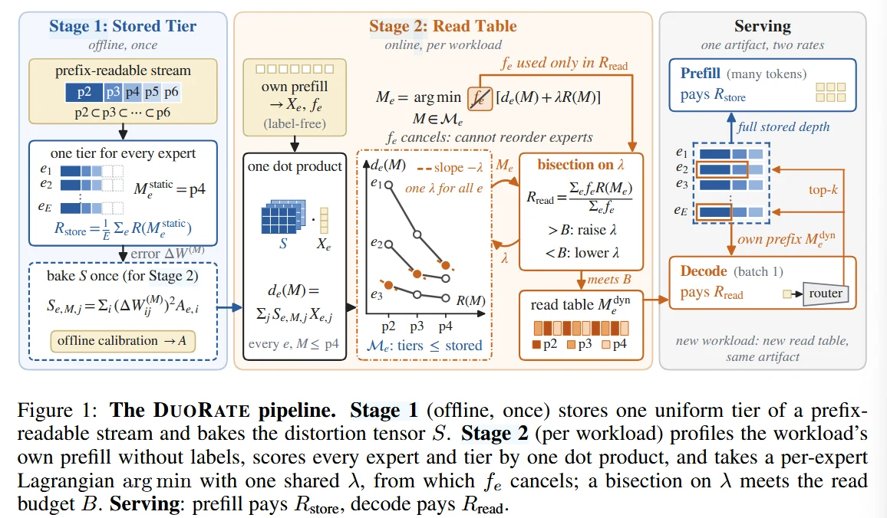

# DuoRate: Two-Rate Per-expert Precision Allocation For Mixture of Experts Serving

DuoRate提出了一个问题: 一个MoE 模型需要存储多少权重，与它在每个Decode Step中实际读取多少权重是不是同一个问题?

然后答案是: 不是。

# Abstract

作者认为，MoE Serving 会在两个不同的地方为权重精度付出成本。其中，第一个是常驻权重存储成本。 假设一个MoE 存128个A8,为了支持任意Router决策，模型通常需要存储全部128个Expert，因此存储预算需要考虑所有expert的权重。 然后第二种就是Decode Read Traffic.在实际执行一个step的时候，主要需要读取被选中的expert的权重以及必要的共享计算数据。

$$
R_{store} = \frac{1}{E} \sum^{E}_{e=1} R(M_e)
$$

以及

$$
R_{read} = \frac{\sum_ef_eR(M_e)}{\sum_ef_e}
$$

其中

- Me是expert e的精度
- R(Me)是该精度对应的实际编码位宽
- fe 是该expert被路由选择的次数

## Observation of BitsMoE 

作者发现BitsMoE公开的Qwen3-30B-A3B中有一个Store-Read Gap

BitsMoE中，存储的成本为2.54 BPW 但是，Decode部分却有 7.50 BPW / activated Weight 的代价。

我们回忆一下BitsMoE的SSD

$$
W_e = P_eA_e\phi^T
$$

多个Expert共享一个Spectral Basis Φ, 存储的时候这个shared basis是被128个expert 共同分摊的，但是实际上decode的时候，只有8个expert被激活，而shared basis仍然需要参与计算，所以这个本来应该被分摊的共享基成本变大了。

# Introduction

为什么现有bit allocation 有问题

论文认为，传统的MoE Mixed-precision Allocation 一般是在求解:

$$
min_{b_e}\sum_eD_e(b_e)
$$

同时满足

$$
\sum_eS_e(b_e) \leq B
$$

这里的优化目标包括Weight Error\\ Activation-aware Error \\ Routing Importance 等信息

但不管是使用哪一种Cost Model ， 大部分工作只明确约束Stored Rate.

所以DuoRate提出的观点是这样的: 对于Batch = 1、 长输出的Decode Serving ，真正需要控制的可能是Routing-weighted Read Rate，因为同一个expert如果频繁被激活，每次生成token都要支付读取成本，而不常激活的expert，即使常驻内存，也不一定带来同样的decode traffic

所以作者希望的是，能否只保存一份模型权重，却让不同的workload在docode的时候使用不同的读取精度?

# Methodology

分为两个部分

1. Stage1: Offline 所有expert存储统一的可截断精度流
2. Stage2: Per-workload 根据Workload的Prefill Activation 统计，计算每个Expert 应该读取的精度

它有一个关键的基础是什么呢，就是一个权重要这样存

b1b2  b3  b4

其中，b1b2是base,然后b3和b4都只是为了增强语义的表述.

作者基于StagQ 格式实现，使用两位Base Code 和 逐位RefineMent Planes

然后根据workload，让每个expert在decode的时候选择p2\\p3\\p4

所以这里必须区分: DuoRate并不是把一个30B模型存储压缩到了2.3BPW，而是在存储约4.27BPW的expert的时候，让Decode的平均读取成本下降到 2.3BPW

## Observation: Routing Frequency has another meaning

我们之前一直觉得，一个expert如果经常被路由，那么就应该给他更多的bits，这也是之前MoE QUANT 的核心思路之一。但是DuoRate认为，在特定的Decode情况下，Routing Frequency  实际上会从每个expert的最优选择公式中消失

作者考虑

$$
min_{M_e} \sum_ef_ed_e(M_e)
$$

通过构造Lagrangian，最后实际上发现Routing Frequency被消掉了，但是为什么呢，因为一个expert被访问的越多，量化误差就会触发更多次，但是他的读取成本也会被支付越多次。两者被相同的频率放大，所以就抵消掉了。

## Stage1: Offline Distortion Modeling

我们现在可以选择p2\\p3\\p4 的模型权重，但是我们如何判断对于一个expert，从p2升级到p3值不值得?

作者定义了一个量化失真函数

$$
d_e(M)=
\sum_{i,j}
\left(\Delta W_{e,ij}^{(M)}\right)^2
A_{e,i}X_{e,j}
$$

这里有三个因素

### 1.Weight Quantization Error:

$$
\Delta W_e^{(M)}
=
\hat W_e^{(M)}-W_e
$$

### 2.Input activation

$$
X_{e,j}=\mathbb E_t[x_{t,j}^2]
$$

表示当前workload在expert通道的二阶矩阵

### 3.Output-channel Importance

$$
A_{e,j}
$$

表示expert输出通道i对最终决策的敏感程度.

然后通过把和workload无关的内容离线提前计算，减少了大量的运行时计算量.

## Stage2: 根据workload动态读取

当一个新 Workload 到来，作者让模型先处理该 Workload 的 Prefill，收集两个统计量

$$
X_{e,j}=\mathbb E_t[x_{t,j}^2]
$$

以及EXPERT ROUTING COUNT 统计被选中的次数

这里不需要输出标签，也不需要再训练模型

求解的内容就不说了，涉及到一些算法。

## Problem

第一，Distortion Model 仍是近似。

虽然作者引入了 Decision-aligned Output Weight，但它仍然采用按元素平方误差的可加形式。是否能够准确预测最终生成质量，需要独立实验。

第二，Prefill Statistics 未必代表 Decode Statistics。

尤其对于长推理链，后续生成的 Token 可能与 Prompt 分布明显不同。

论文确实比较了两者的 Read Rate，在 GSM8K 上，预算 2.9 BPW 对应的实际 Decode Read Rate 约为 2.82 BPW，说明存在一定偏移。

第三，也是最重要的：目前没有真正的 Prefix-read Kernel。

作者提出了一条理论上可以少读取数据的执行路径，但实验中的质量评估使用的是反量化后的 BF16 权重。因此它尚未证明这些理论节省能够转化为实际 GPU/NPU 的延迟下降。

# Experiment

DuoRate 在 2.9 Read BPW 下，平均准确率已经接近 4-bit 格式。

GSM8K 尤其明显：DuoRate 在 2.9 BPW 时达到 91.00%，BF16 是 91.25%。

但是有个重要问题：

DuoRate 存储的是 4.27 BPW 权重，而 GPTQ 等方法存储的是约 2-bit 权重。

所以这里证明的是：存储较高精度的模型，可以通过动态减少读取深度，维持较好的质量。

它并没有证明 DuoRate 是存储压缩率最好的方法。

## Ablation

作者专门设计了相同 StagQ 格式、相同 Read Budget 的对照。

DuoRate的Allocation确实有用，但是收益没有Main Result那么大的感觉.

# Summary

整篇文章就是前面亮瞎眼，但是后面给人的感觉是"也就那样"

为什么呢,因为他在做实验的时候，其实是不公平的。

它比较的一个指标是相同的READ bpw，关键是你自己存的就是4bpw量级的，你虽然只读了部分权重，但是你整个存储是人家的两倍。

就好比，你用Qwen3 30B-A8B 和 Qwen 8B 比较。你说我们都是8B，然后我比他牛逼多了，事实上什么情况明眼人都清楚吧？
