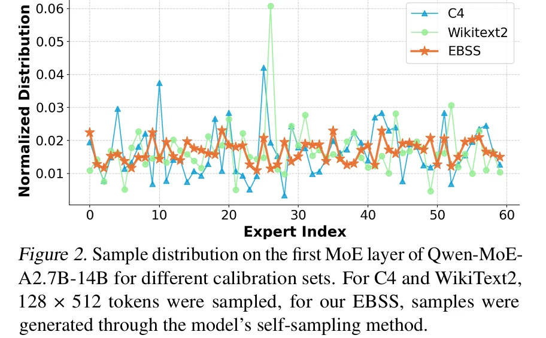

# MoEQuant:Enhancing Quantization for Mixture-of-Experts Large Language Models via Expert-balanced Sampling And Affinity Guidance

- ICML 2025
- TLDR: 传统GPTQ、AWQ的Calibration 方法，是否真的时候MoE 这种稀疏激活的模型？

# Abstract

作者认为，传统的PTQ 直接迁移到MoE的时候，会遇到两种不均衡

| 问题                     | 含义                                   | 方法   |
| ---------------------- | ------------------------------------ | ---- |
| Inter-expert Imbalance | 不同exepert接收到的calibration tokens 数量不同 | EBSS |
| Intra-expert Imbalance | 同一个expert收到的不同token路由的重要性不同          | AGQ  |

### 1.Inter-expert Imbalance :  有些expert根本没有被充分的校准

我们以GPTQ为例，普通的Dense LLM 的每个FFN都会处理calibration set里面的全部token，但是MoE是不一样的，假设一个MoE 有128expert 每个token选择8个,假设现在我们送过来128个token来激活。。如果完全均匀的话，每个expert会得到8次activation

但是实际上routing是不均匀的，某些expert可能收到30个token，某些expert可能只有俩。

所以用GPTQ为不同expert得到的激活统计，质量就存在明显的差异,例如GPTQ使用

$$
H = 2XX^T
$$

来估计量化误差的二阶信息，如果某个expert只获得极少数calibration tokens，它的H就很不稳定

因此，作者认为，MoE QUANT 不只是Weight Quantizer的问题，还首先是Calibration Data Converage的问题

Qwen MoE 各个expert的calibration sample如上所示。C4和 wikiText有明显的尖峰，而作者的EBSS相对比较平稳

### EBSS: 怎么获得Expert-Balanced calibration Data

EBSS全程Expert Balanced self sampling

思路不是简单的对现有数据重复采样，而是让模型自己生成calibration data，同时尽量让不同expert获得均衡的激活机会.

作者希望生成的数据同时满足两个条件:

Low Perplexity + Expert Balance

但是为什么需要low perlexity呢，因为如果只是追求使用次数相等的话不会很搞笑吗？

所以作者设计了一个联合目标

$$
\boxed{
\min_D\left[
\log\operatorname{PPL}(M,D)
+\frac{\sigma(M,D)}{\tau}
\right]
}
$$

- ppl 衡量数据是否自然
- σ（M,D） 衡量不同expert 的activation frequency
- τ: 控制权衡，超参

但是低PPL不一定是有更好的任务泛化能力

### Intra-expert Imbalance

expert内部的不均衡。

假设两个token都被路由到了expert e，但是routing score不同，那么最后的输出也是不同的

所以，routing score 较高的时候，同样的expert output error 可能对最终moe输出产生更大的影响。AWQ认为weight error x activation 才能体现输出的影响，而对于MoE而言，还需要考虑token-exeprt affinity,即routing weight

### AGQ : 把routing score 加入目标

$$
\boxed{
\mathcal L_{\mathrm{AGQ}}
=
\sum_tg_e(x_t)
\left\|
Wx_t-\hat Wx_t
\right\|_2^2
}
$$

这样，routing weight大的token，量化误差的影响也大。

# Methodology

## Expert-Balanced Self-Sampling(EBSS)

为什么不能从C4采样？主要是因为MoE的router不会均匀的选择全部expert，因此可能有些expert收到了很多，有些却几乎没有。

所以作者的想法是

**能否让原始LLM自己生成一批数据，使得这批数据复合模型分布的同时涵盖更多expert**

目标函数: 低PPL + 负载均衡

作者采用类似 Beam Search 的策略。构建calibration data

## Affinity-guided Quantization (AGQ)

AGQ的本质就是让GPTQ的误差补偿过程能够感知每一个token和expert的routing affinity

**不过这里有个思考就是，如果有些expert在我们常用的负载本来就不怎么量化的话，那么浪费算丽在其上进行专门的calibration优化是否会浪费我们的算力?**

# Experiments

**Main Results：INT4 下的效果**

| 模型             | FP16  | QuaRot + GPTQ | MoE Quant++ |
| -------------- | ----- | ------------- | ----------- |
| Qwen-MoE-14B   | 51.2  | 49.00         | 49.59       |
| DeepseekMoe16B | 40.86 | 39.01         | 40.01       |
| Mixtal-8x7B    | 56.8  | 53.42         | 55.58       |

**INT3：极低位宽下的效果**

| models           | FP16  | QuaRot + GPTQ | MoEQuant++ |
| ---------------- | ----- | ------------- | ---------- |
| Deepseek-MoE-16B | 40.86 | 35.85         | 36.47      |
| Mixtral-8x7B     | 56.80 | 45.03         | 49.75      |

Mixtral 提高了 4.72 个百分点，说明改善校准策略在较低位宽下也有价值。

但 DeepSeek 的改善只有 0.62 个百分点

**Ablation**

EBSS的作用更大。

# summary

核心就是把calibration训练的数据均匀分配给各个expert，硬要说系统上面倒没什么优化，就是改了个数据。

额，至于它那个AGQ，把score纳入的我表示怀疑，我感觉不如用activation + 线性规划搜索的效果好。
