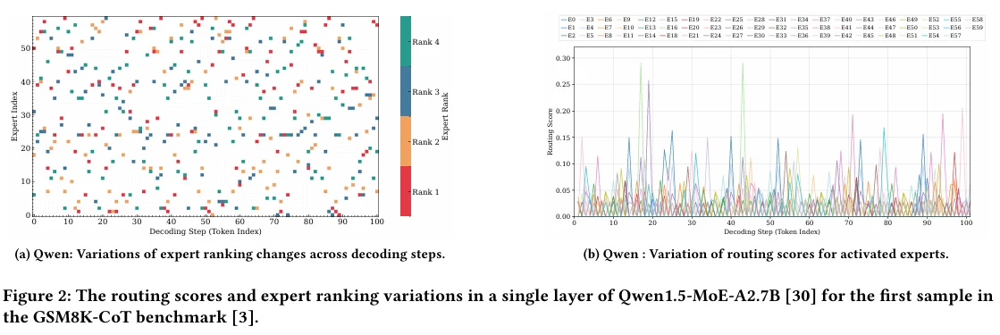

# MatMoE: Matryoshka Mixture-of-Experts with Dynamic Mixed-Precision Quantization for Efficient Inference

- ICCAD 2026

# Abstract

## 问题1: Expert的重要性是随着Token动态变化的，但是现有的Mixed-precision Quantization 通常是静态的。

例如一个MoE层里面有Expert A 和 Expert B 

对于Token 1 来说，A可能更重要，但是对于Token 2 ,B 可能更重要。

传统static Mixed Precision 在离线校准的时候就决定 bits width，但是MatMoE 希望每个token都能够重新决定

$$
\text{Token 1}: b_A = 4, b_B = 2
$$

$$
\text{Token 2}: b_A = 2, b_B = 4
$$

这就是Token level Dynamic Mixed Precision

## 问题2 Edge Devices 的延迟要求会发生变化

比如设备上面还有别的程序，系统的可用贷款和资源会随时变化。

作者希望调整目标平均bitwidth，在质量和延迟之间动态取舍。而不是使用固定的量化精度

## Core Method

作者提出了三种设计

1. Matryoshka MoE PTQ  训练一份支持多种执行精度的模型表示，并为每个expert离线确定最高的位宽
2. Floor - and - Compensation Quantization 利用截断和步长，避免为了低精度舍入而额外读取一个bit plane
3. Dynamic Bit Width Allocation 根据当前token的routing score 选择高低执行精度，并通过阈值控制平均bitwidth

所以我们可以看得出来，这个文章的核心想法和DuoRate是很像的，都是存比较高精度的，但是实际上只用一个部分。

不过DuoRate的目光更多放在一个Workload 用什么精度，而matmoe 则是当前这个token 应该用什么进度。

Duorate的分配目标更精细，而MatMoE 简单一些，主要用Routing Score 作为重要性代理。

# Introduction

### motivation I:

作者用Qwen 1.5Moe-A2.7B 观察了前100个DecodeStep中Expert的排序和routing score

Figure2(a) 表示，同一个expert 在不同的Token上面的routing rank 会变化

Figure2(b) 表示被激活expert的 routing score 存在明显波动

### motivation II

作者认为，端侧设备的资源利用率可能发酸变化，因此有必要支持不同的平均执行精度。

例如

$$
P_{target} = 2.5
$$

意味着被激活的expert的平均执行位宽希望被控制在2.5 bit左右

MatMoE 使用离线确定的Routing Score Threshlod,让高分Expert 运行在高精度，低分expert用低精度

（不过这个地方就很显然直接用得分代替重要性了，我们这和东西按理来说是不保证的，我觉得还是activation aware 会好一些）

### motivation III

Matryoshka Quantization 存在多余的读取

假设权重存的是4-bit，我们想用2-bit，普通舍入需要查看被丢弃部分的最高位，判断需要进位与否。

因此，使用2bit的话得读取3bit，所以会削弱我们在节约访存上面的收入

所以他们提出了Floor-and-compensation

$$
q_{low} = \lfloor\frac{q_{high}}{2^{\triangle}}\rfloor
$$

由于直接floor会向下偏移，所以他们再补偿被截断部分的期望

$$
C = \frac{2^{\triangle } - 1}{2}
$$

$Δ = b_{high} - b_{low}$

# Methodology ＆ Experiment

| 模块                     | 具体方法                                   | 判断     |
| ---------------------- | -------------------------------------- | ------ |
| Matryoshka MoE PTQ     | 离线ILP 分配最高位宽，再通过过多进度输出MSE优化OmniQuant参数 | 已有技术组合 |
| Floor and compensation | 用截断加期望值补偿避免额外读取rounding bit            | 可以     |
| Dynamic allocation     | 当前routing score 超过就用高精度，否则用低精度         | 简单     |

### 动态精度分配确实改善了质量

| 指标        | 静态PMQ | MatMoE |
| --------- | ----- | ------ |
| GSM8K-CoT | 27.7% | 36.5%  |
| HumanEval | 3.7%  | 26.8%  |
| MBPP      | 6.8%  | 26.2%  |

提升很明显。

### 系统收益来自于kernel

| 方法                     | TPOT   | GSM8K |
| ---------------------- | ------ | ----- |
| PMQ + llama.cpp        | 80.3ms | 27.7% |
| PMQ + new kernel       | 27.3ms | 27.7% |
| 原始Matryoshka + Dynamic | 30.5ms | 35.6% |
| 完整MatMoE               | 27.6MS | 35.6% |

收益主要来自于新的kernel
