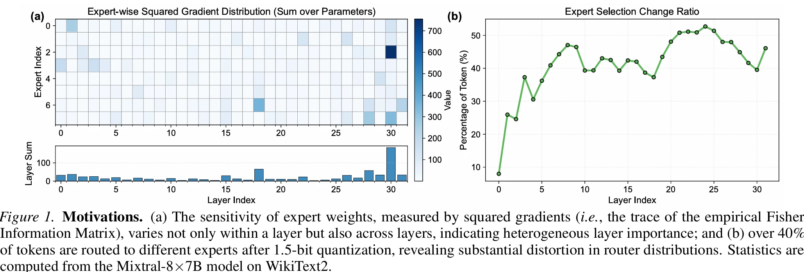

# GEMQ: Global Expert-level Mixed-Precision Quantization for MoE LLMs

- ICML 2026 PMLR 306:24313-24333

# Abstract

作者认为，已有的MoE Mixed-precision PTQ存在两个不足

1. **Local Bit Allocation 忽略了跨层重要性**

之前Mixed Precision 一般会对MoE layer 独立分配预算，比如一个模型有32个MoE layers，每层8个expert,我们希望平均使用2个bit

传统做法可以是，每层都有16bit的分配预算，再根据内部各个expert的重要性进行分配。

但是这里有一个假设，是**不同层应该获得相同的Bit Budget**

但是，GEMQ认为这个假设是不合理的，因为某些层可能对最终任务损失非常敏感，另外一些则没有那么敏感。因为某些层可能最终任务损失非常敏感，另外一些则没有那么敏感。

所以，作者希望想要把

$$
min_{b_{l,e}} \sum_e C_{l,e}(b_{l,e}) 对每一层独立求解
$$

**变成一个跨全局的bit budget**

但是这个地方不是说就是简单的把不同层放到同一个ILP中，还要求Cost必须有可比性

比如第三层的cost为100，第二层的cost为10，我们还得知道他们衡量的模型损失是否相同。

2. 量化会引起 Router Distribution Shift

这个问题很典型，之前的Proquant也提到过。假设当前层的router权重没有量化，前面层产生的hiddent states error 也会改变状态，原本路由到expert3 的token可能会被错误的导向expert5

额，当然这个地方不是说就要一定交给expert3，因为如果是目标能够对齐的话，就算不一样也没啥。

这个地方作者的观点是: **既然expert自己都量化了，功能变化了，那么原来的router也未必是量化模型的最佳router**, 所以他指出，我们可以冻结量化之后的expert，只ft router，让路由策略适应新的expert。

**注: 我们先前看过的ProQuant倾向于保持Routing Consistency 的思路有分歧，**

# Introduction 

Figure1(a) 显示，左侧热力图用各个expert的 经验fisher trace衡量敏感性，可以发现，敏感性不仅仅只是在同层expert之间不同，不同layer之间变化也很大

Figure2(b) Expert selection Change Ratio 右侧折线图表示很多中后层的expert selection 相对于原模型发生了变化，部分层达到50%

第一张图应该支持了global allocation的必要，因为很显然敏感性不是说每层独自分配的etc.

**Contribution3,Progressive Quantization**

作者还发现直接从FP16模型估计1.5bit下的expert importance 可能不准确，原因是量化模型误差太大的时候，router选择和后续hidden states 已经明显变化，原来基于FP模型建立的局部损失近似可能失效

所以和我们之前看到的那个bit by bit不一样，他们是通过从 FP16 Teacher 量化到 2.5bit allocation + GPTQ + Router ，再用2.5bit模型重新估计importance，最后再到1.5bit

GEMQ使用Progressive Quantization 主要是改善低位宽的Importance Estimation.

# Methodology

## 1.Global Expert Bit-width Allocation

这部分是GEMQ的核心

我们先来看一个问题，为什么不同层的误差之间是有区别的？

假设两个expert分别在第三层和第二十层，量化后他们造成的局部输出误差相同，可能都是0.1，但是这并不意味着最后他们对模型的质量影响是一样的，因为后续网络对这些误差的敏感程度很可能不同，所以GEMQ不直接用

$$
C_{l,e}(b) = ||\triangle_{z_{l,e,b}}||^2
$$

而是希望直接量化这个expert会导致多少最终语言模型cross-entropy Loss的增量。所以这样不同的layer 的cost才会具有统一的比较尺度

所以看看作者最后是如何近似最终的Task Loss的？他们这个地方很简单的方式是采用了二阶泰勒展开。

他们假设原来的模型接近驻点，忽略了一阶项，并通过Gauss-Newton近似，将weight Perturbation 转换到Block Output Space，但是要算完整的H分布还是太贵，所以他们又用了 Diagonal Fisher Approximation 近似

最后得到的cost是

$$
\
\boxed{
\Delta\widetilde{\mathcal L}_{e,b}
=
\mathbb E_D
\left[
\Delta z_{e,b}^{\top}
\operatorname{diag}(g_zg_z^\top)
\Delta z_{e,b}
\right]
}
$$

这个公式的含义其实非常直接：

**量化误差不仅要看大小，还要看误差所在的输出方向对 Task Loss 有多敏感。**

**举个例子来讲，就好比某个输出通道的梯度平方是其他通道的一百倍，那么相同大小的误差，在这个代理目标下的cost也是一百倍。**

但是呢，GEMQ的近似是不精确的，Diagnoal Fisher忽略了通道的交叉项，量化某个expert之后，后续的router selection 可能会变化，所以尽管他比普通的MSE更具有Task-awareness，但是仍然是一个Surrogate cost，这和我们此前观察到的局部误差和最终生成质量的mismatch是对的上的。

就这样，作者通过这个方式得到了一个所有expert在候选位宽下的cost之后，约束主要的位宽，最后通过ILP搜索 + 一个 “每层至少保留一些高精度expert的限制”,来构建了最后的一个量化位宽的选择.

## 2.Router Fine-tuning

现在我们已经量化好了expert们，然后现在我们冻结这些expert各自的权重不变，只更新 router的权重，继续整体优化

$$
\min_{W_{\mathrm{router}}}
\mathcal L_{\mathrm{CE}}(M_Q;D_{\mathrm{cal}})
$$

作者很慷慨的允许router根据量化后的expert质量重新选择专家。 例如，原模型更喜欢expert A, 但是如果A被量化的多，可能router会更积极的使用B

## 3.Progressive Quantization

这部分就不是特别大的啥优化了。

作者认为，1.5-bit 量化时产生的 Weight Perturbation 太大，如果仍然在 FP16 模型附近估计敏感性，二阶近似可能不准确。

所以是通过FP16估计cost得到2.5bit， 然后2.5 bit + router FT 重新估计cost得到2.0bit，最后通过 2.0 bit + Router FT -&gt; 1.5 bit

# Experiment:

就不写出来了，写表麻烦反正**GEMQ 对 Qwen3 的改善非常明显，但在其他模型上，尤其是 1.5-bit 的 Mixtral 和 DeepSeek，优势其实有限。**

Global Allocation 有价值，但是收益还是依赖模型和预算的

然后Ablation中显示 Global Allocation 确实是在不同的层上面联合分配，然后Fine-tune Router 比不做的router 的 PPL 小几个点。

Progressive Quantization 大概也提升了几个百分比

# Summary

核心来看，这篇文章的关键点就主要在于它那个router的 fine tuning。后面别的量化其实都是比较虚的，因为联合优化算是很明显的东西了。
