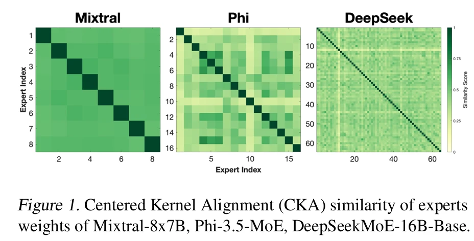
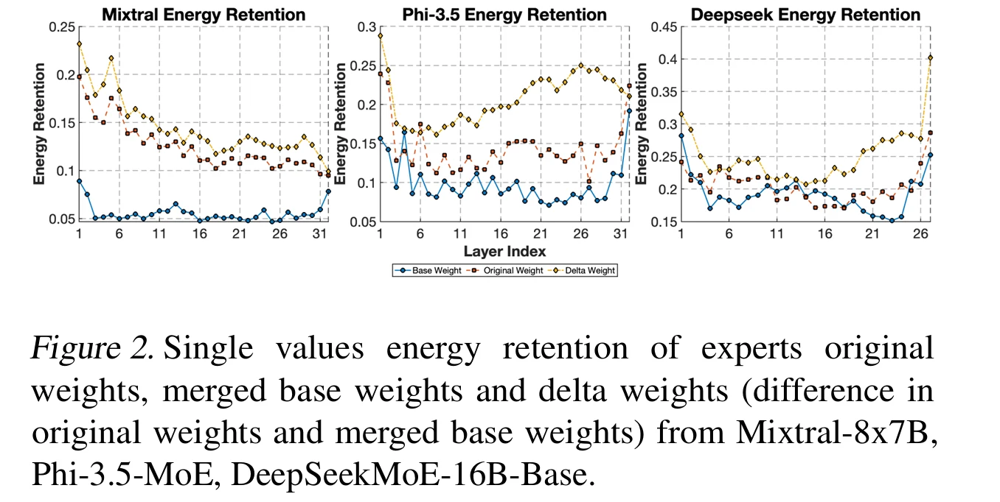
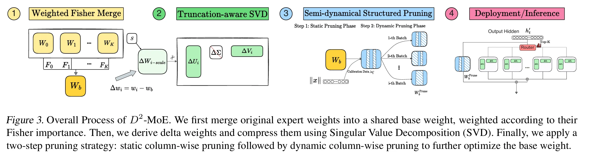

# Delta Decompression for MoE-based LLMs Compression

- ICML2025

# Abstract

作者的核心思想很简单，对于一个专家的权重，我们有

$$
W_e = W_{base}  + \Delta W_e
$$

对于一个MoE Layer,我们有

- $W_{base}$ 是所有expert可以复用的共享权重
- $\Delta W_e$ Expert e相对于共享权重的特殊部分

作者的想法是，既然这些Delta Weights 只表示Expert 之间的差异，那么他们有可能比原始权重更容易压缩。

因此，作者不再分别完整存储每个expert的权重，而是保留一份共享的base，再给每个expert存储一个低秩近似的delta.

原始的Delta分解是精确的，但是将delta截断为低rank矩阵之后就产生了近似的误差。

这个方法有三个步骤

| 方法                              | 问题                     |
| ------------------------------- | ---------------------- |
| Fisher-weighted Merging         | 如何得到的具有代表性的shared base |
| Trucation-aware SVD             | 如何压缩每个expert的delta     |
| semi-dynamic Structured Pruning | 进一步减少Shared Base的冗余计算  |

# Introduction

## Problem Formulation

为什么已有的MoE 压缩并不让人满意?

1. Expert Pruning

例如有些原本有8个expert，直接删除掉四个，当然能够减少参数，但是存在一个问题，被删除的expert原本具有的功能也可能消失

模型里面自带的expert Redundancy是不够保证这些东西能被找补回来的

2. Expert Merging

另外一些路线是把几个expert合并为一个，但如果这些 Expert 只有一部分知识是共享的，另一部分具有各自的特殊性，直接 Merge 就可能丢失这些差异。

所以作者的想法是: 能不能只Merge 共享的部分，同时把expert之间的差异保留下来,D^2-MoE就是这个问题。

我们之前看了KBVQ-MoE, 这个东西是很相似的，不过方法不太一样。

## Observation

1. 不同的experts之间到底有多么相似?

作者利用Centered Kernel Alignment (CKA) 衡量了不同expert 权重之间的相似性,在上图所示的三种expert下，作者报告了不少约为0.3\~0.5的跨专家相似性.

这说明了Expert之间存在结构重合，但是没有达到可以随意合并的程度

所以作者认为保持共享部分是合理的，但是不能牺牲expert 的 Diversity

Delta Weights 是否更适合做SVD呢，作者上图中比较了Expert Weights\\Merged Base Weight 和 Delta Weight的奇异值能量保留情况。

他发现，Delta的能量能够在较少的奇异方向中有明显的集中现象。因此提出:

$$
\Delta W_e\approx U_e^{(r)}\Sigma_e^{(r)}V_e^{(r)\top}
$$

如果保留的rank r 远小于矩阵维度，那么就能用两个较小矩阵表示Delta。

# Methodology

我们前面已经提到了，作者把每个expert写作:

$$
W_e = W_{base} + \Delta W_e
$$

进一步使用低秩分解之后，得到

$$
{W_e\approx W_{\mathrm{base}}+U_eV_e}
$$

这样所有expert只需要存储一份W\_base，以及两个low-rank矩阵

作者围绕着这个思想，做了三个优化

| 技术                      | 作用                       | 创新                  |
| ----------------------- | ------------------------ | ------------------- |
| Fisher-weighted Merging | 确定共享base 优先考虑敏感权重        | 既有fisher merge思想的应用 |
| Activation-aware SVD    | 输入加权的空间中压缩Delta          | 基于已有的SVD-LLM        |
| Semi-dynamic Pruning    | 静态删除不重要的base通道，动态跳过别的低贡献 | 系统执行方面的拓展           |

# Experiment

## 1. main Result:**参数压缩**

最有价值的是 60% 参数削减时，D²-MoE 仍然保留了 52% 的平均准确率，而另外两种方法只有 36%。

不过这主要是与结构剪枝、专家压缩方法的比较，不是优于同等实际字节预算下的极低比特 VQ、GPTQ 等方案。

## 2. Ablation: 核心模块

**1. Fisher Merge 优于普通平均**

**2. Delta SVD 的贡献 有，但是是借鉴的**

**3. Semi-dynamic Pruning，基本上没有优化**
