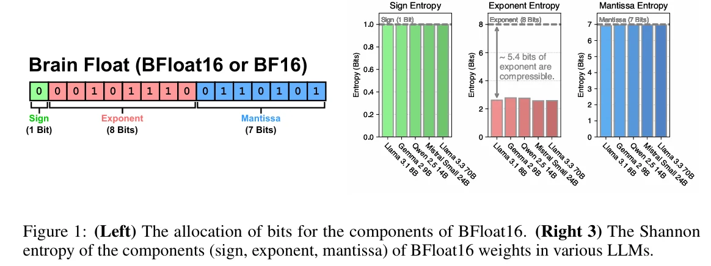
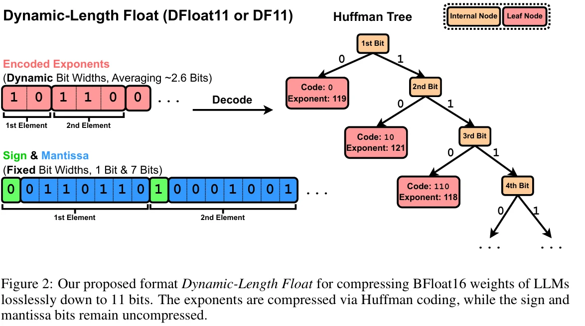
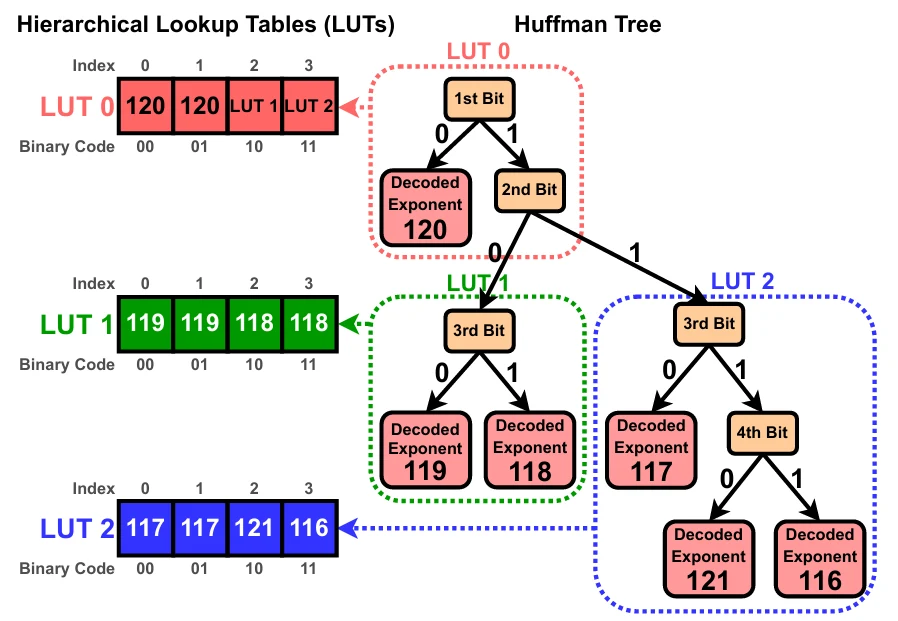

# 70% Size, 100% Accuracy: Lossless LLM Compression for Efficient GPU Inference via Dynamic-Length Float(DFloat11)

## 1. 核心思想: BF16 的16bit其实有很大的信息冗余

我们知道，BF16的的格式是: sign 1bit, Exponent 8 bits, Mantissa 7 bits

但是，作者实际观察到:

| 字段       | 原始位宽  | 实际信息熵    |
| -------- | ----- | -------- |
| Sign     | 1bit  | 接近1bit   |
| Exponent | 8bits | 约2.6bits |
| Mantissa | 7bits | 接近7bits  |

虽然我们用8bit来表示Exponent，但是真实模型的exponent分布不均匀

举个例子:

模型权重一般会集中在某些数量级，例如 10-2， 1e-3, 1e-4附近

因此，256种可能的BF16 exponent中，真正出现的通常只有40种，而且其中几种很常见。所以作者想到的是既然指数的熵只有2.6bits，为什么非要用8bits表示呢?

根据Shannon信息熵:

$$
H(X)=-\sum_x p(x)\log_2p(x)
$$

可以通过熵编码，把常见的exponent用短编码表示，而罕见的exponent用较长的编码,这就是DFloat11的基本出发点。

## 2.压缩方式:

Huffman Coding (哈夫曼编码).  假设我们统计了某个模型所有权重的exponent，把它按照前缀编码即可。

那么编码之后的BF16 就从 1 / 8 / 7 变成了平均 1/ 2.6 / 7 的大小。理想情况下就是 1+2.6+7 = 10.6 bits/weight

这个过程都是不进行数值近似的，所以理论上可以重建逐个bit相同的BF16权重

## 3.GPU如何高效解码

普通的定长数据是非常容易并行的，但是Huffman编码是变长的，我们事先不知道第exponent从哪个bit开始，更不知道每一个GPU Thread应当输出矩阵的什么位置/

作者围绕着这点展开了三种优化

### 3.1 Hierarchical LUT:

正常的Huffman解码需要沿着二叉树遍历，但是这很麻烦，所以作者采用了Lookup table，假设最长编码为Lbits，那么可以构造一个 LUT\[0...2^L -1\] ，读取接下来的L bits,直接看到对应的exponent， 再根据codelengths直接知道实际上小消耗了多少bits

但是实际上单张LUT可能需要2^32项，超出了GPU SM的da'xi熬，所以作者把LUT分层。每张小的LUT只处理接下来的8bits，因此只有256个entries，遇到复杂编码就跳转到下一层LUT，否则直接返回exponent

论文里声明，实际只需要4\~8张小LUT，加上CodeLengths表总共2.25KB，这样就能放得下了。

### 3.2 Two-Phase Kernel 两次解码并行写入问题:

作者规定每个thread负责8bytes的压缩exponent数据，但是因为编码变长，这8个bytes可能从某个exponent的中间开始，而且各个线程能够接出来的元素数量不同，所以需要两种辅助的数据

Gaps: 记录每个thread从自己的字节块开始要跳过多少bits才能遇到一个完整的Huffman的起点

BlockOutPutPos: 记录每个CUDA thread Block对应的第一个输出元素的位置

之后进行两阶段的解码

压缩的Exponent Bitstream -&gt; Phase1: Count，根据Gaps找到解码起点，各个线程解码并统计元素数量 -&gt; Block-level Prefix Sum 计算Thread的输出便宜 -&gt; Phase2 Decode ＆Write 重新解码，和原始的sign / Mantissa拼回BF16 

最后通过Coalesced HBM Writes 连续写出完整的BF16权重矩阵

### 3.3 Transformer Block-Level Decompression 

什么时候解压缩呢，作者采用了比较直接的方式

GPU HBM 常驻 DF11压缩权重，解压到当前Transformer Block 然后用临时的BF16 Buffer -&gt; 正常 GEMM ，然后释放BF16 Buffer，继续下一个Transformer Block。

多个矩阵一起解压可以提高解压kernel的吞吐.

## 4. Experiments

Llama 3.1 8B 16GB -&gt; 10.9GB

Qwen3 14B 29.54GB -&gt; 20.14GB

Llama 3.3 70B  141.11 GB -&gt; 95.40 GB

Llama 3.1 405B 811.71 GB -&gt; 551.22 GB

然后在很多地方，BF16需要Offloading，但是DF11不需要，所以这样就让DF11的吞吐提升了2.31 \~ 46.24x。
